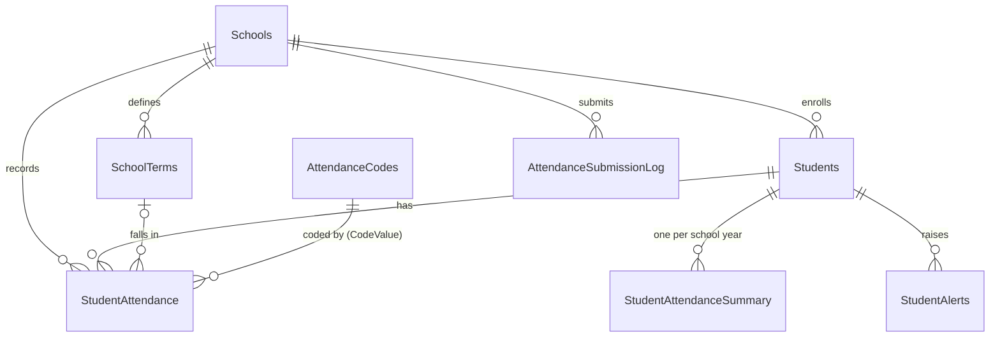
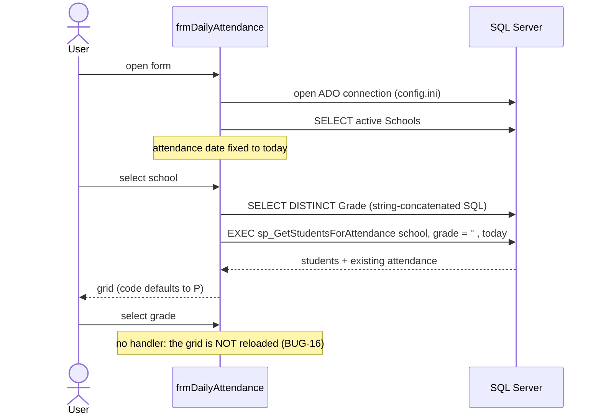
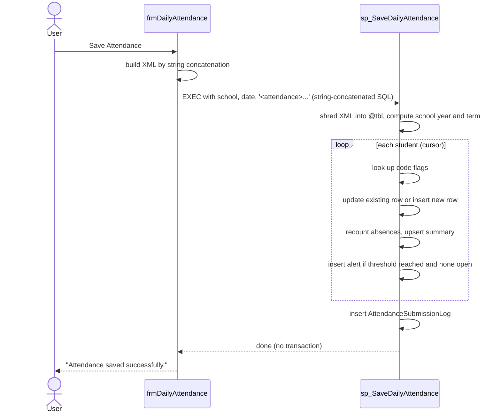

# Legacy System Analysis

Analysis of the legacy attendance application in [`legacy/`](../legacy/), the reference for the port. Findings carry IDs (`R-n`, `V-n`, `SEC-n`, `BUG-n`, `AMB-n`, `MIS-n`) so later decisions, tests and commits can refer to them.

This analysis covers the whole legacy app. The port only covers the use cases in [0.scope.md](0.scope.md); findings about anything outside that scope (form, printing, student lists, alert resolution) are context only.

## 1. Inventory

| File | Kind | Purpose |
|------|------|---------|
| [`Forms/frmDailyAttendance.frm`](../legacy/Forms/frmDailyAttendance.frm) | VB6 form | Desktop UI for entering one day's attendance for a school and grade |
| [`Database/schema.sql`](../legacy/Database/schema.sql) | DDL | Tables `Students`, `AttendanceCodes`, `StudentAttendance`, `StudentAttendanceSummary`, `StudentAlerts` |
| [`Database/sp_SaveDailyAttendance.sql`](../legacy/Database/sp_SaveDailyAttendance.sql) | Stored procedure | Saves a batch of daily attendance, recounts absences, raises chronic-absence alerts, logs the submission |
| [`Database/sp_GetStudentAttendance.sql`](../legacy/Database/sp_GetStudentAttendance.sql) | Stored procedure | Returns one student's attendance history and absence summary for a school year |

### Referenced but missing

The source refers to objects that are not in the repository. Their shape has to be inferred from usage:

| Object | Referenced from | Inferred columns / contract |
|--------|-----------------|------------------------------|
| `Schools` table | form, both procedures | `SchoolID`, `SchoolName`, `Active`, `AbsenceAlertThreshold` (nullable, default 10 in code) |
| `SchoolTerms` table | both procedures | `TermID`, `SchoolID`, `TermName`, `StartDate`, `EndDate` |
| `AttendanceSubmissionLog` table | `sp_SaveDailyAttendance` | `SchoolID`, `SubmittedDate`, `AttendDate`, `RecordCount`, `SubmittedBy` |
| `sp_GetStudentsForAttendance` procedure | form | `(@SchoolID, @Grade, @AttendDate)` → `StudentID`, `LastName`, `FirstName`, `AttendCode`, `MinutesLate`, `Notes` (existing attendance for the date, nullable) |
| `SchoolYear()` scalar function | `sp_SaveDailyAttendance` | `DATE` → `'YYYY-YYYY'` school year string |
| `Nz()` helper | form | Access-style null coalesce; not a VB6 built-in, so a missing module |
| `config.ini` | form | Connection settings |
| `Reports\DailyAttendance.rpt` | form | Crystal Reports daily attendance report |

## 2. What the application does

A school staff member (teacher or office clerk) records daily attendance:

1. Pick a **school**, then a **grade**.
2. The grid lists the school's active students with any attendance already saved for **today**. Students with no record default to code `P` (present).
3. For each student, enter an **attendance code** (for example `P`, `A`, `L`), **minutes late** and **notes**.
4. **Save Attendance** sends the whole grid to the database in one call.
5. **Print Report** prints the Crystal Reports daily attendance report for the school and date.

On save, the database:

- **Upserts** one `StudentAttendance` row per student per day. `IsAbsent`/`IsExcused` are copied from the code's definition in `AttendanceCodes`. The current term is resolved from `SchoolTerms`.
- **Recounts** the student's absences for the school year into `StudentAttendanceSummary`.
- **Raises an alert** (`StudentAlerts`, type `CHRONIC_ABSENCE`) when the count reaches the school's `AbsenceAlertThreshold` (default 10), unless an unresolved alert already exists for that year.
- **Logs the submission** in `AttendanceSubmissionLog` (school, date, row count, user).

A separate read procedure, `sp_GetStudentAttendance`, returns a student's history for a school year plus the summary and an `IsChronicallyAbsent` flag. Nothing in the form calls it, so its consumer is unknown (AMB-13).

### Domain concepts (ubiquitous language)

| Term | Meaning in the legacy system |
|------|------------------------------|
| School | Tenant boundary; has an absence alert threshold and terms |
| Student | Belongs to one school, has a grade, can be inactive |
| Grade | Free-text `VARCHAR(10)` on the student, used as the class filter |
| Attendance code | Short code (`VARCHAR(5)`) with `IsAbsent`, `IsExcused`, `IsActive` flags |
| Daily attendance | One record per student per date: code, minutes late, notes, term |
| School year | `'YYYY-YYYY'` string. September 1 starts a new year |
| Term | Date range within a school; attached to each attendance record |
| Attendance summary | Total absences per student per school year (denormalized) |
| Chronic absence alert | Raised once per student per year at the threshold; can be resolved |
| Submission log | Audit of each save batch |

## 3. Business rules

Rules as implemented, including the buggy ones (marked with the bug ID). The port keeps the intent and fixes the defects deliberately.

### Attendance entry

| # | Rule | Source |
|---|------|--------|
| R1 | School year = `Y-(Y+1)` if the month is September or later, else `(Y-1)-Y` | both procedures |
| R2 | One attendance record per student per date; saving again overwrites it | save procedure, lines 54–77 |
| R3 | Blank code is saved as `P` | form, line 109 |
| R4 | `IsAbsent`/`IsExcused` come from the code. An unknown code is treated as present and not excused | save procedure, lines 46–53 |
| R5 | Term is the school's term whose date range contains the attendance date; null if none | save procedure, lines 36–39 |
| R6 | Total absences = count of `IsAbsent = 1` rows for the student at the school in the year (excused absences count) | save procedure, lines 79–84 |
| R7 | Threshold = `Schools.AbsenceAlertThreshold`, or 10 if null; alert when total ≥ threshold | save procedure, lines 97–99 |
| R8 | At most one unresolved `CHRONIC_ABSENCE` alert per student per school year | save procedure, lines 101–107 |
| R9 | Audit: `CreatedBy`/`ModifiedBy`/`SubmittedBy` = `SYSTEM_USER` (the SQL login) | save procedure |
| R10 | History query defaults to the current school year and sorts newest first | read procedure |
| R11 | `IsChronicallyAbsent` = total ≥ threshold (default 10) | read procedure, line 40 |

### Further rules

| # | Rule | Source |
|---|------|--------|
| R12 | Only **active** schools are offered, sorted by name | form, line 47 |
| R13 | Grades offered = distinct grades of the school's **active** students | form, line 62 |
| R14 | A student with no record for the date is shown with code `P`, 0 minutes late, empty notes | form, lines 90–92 |
| R15 | Attendance is entered for one school and one date per submission; the whole grid is one batch | form; save procedure signature |
| R16 | A new record stores `CreatedDate`/`CreatedBy`; an update stores `ModifiedDate`/`ModifiedBy` and keeps the creation audit | save procedure, lines 59–76 |
| R17 | The term is resolved once per batch, from the date and the school | save procedure, lines 36–39 |
| R18 | The summary row is created on the first save of the year and updated with `LastUpdated` on every later save | save procedure, lines 85–96 |
| R19 | Alert message text: `Student has reached {n} absences this year` | save procedure, line 112 |
| R20 | Every submission is logged with the number of rows sent, even when zero | save procedure, lines 120–121 |
| R21 | History rows carry the code description and the term name (null if no term) | read procedure, lines 17–25 |
| R22 | The summary is only returned if one exists for the year; otherwise the second result set is empty | read procedure, lines 41–45 |
| R23 | Attendance codes are unique by value; each code defines whether it is an absence and whether it is excused | schema, lines 12–19 |

## 4. Entities

### Tables in `schema.sql`

None of the tables declare foreign keys; the relationships below are implied by column names and joins.

**Students**

| Column | Type | Constraints / default | Notes |
|--------|------|-----------------------|-------|
| `StudentID` | `INT IDENTITY` | PK | |
| `SchoolID` | `INT` | NOT NULL | Implied FK to `Schools` |
| `FirstName`, `LastName` | `VARCHAR(100)` | NOT NULL | Personal data |
| `Grade` | `VARCHAR(10)` | NULL | Free text; sorts as text |
| `DateOfBirth` | `DATE` | NULL | Personal data; unused by the code |
| `Active` | `BIT` | NOT NULL, default 1 | |
| `CreatedDate` | `DATETIME` | NOT NULL, default `GETDATE()` | |

**AttendanceCodes** (reference data)

| Column | Type | Constraints / default | Notes |
|--------|------|-----------------------|-------|
| `CodeID` | `INT IDENTITY` | PK | Not referenced anywhere; rows link by `CodeValue` |
| `CodeValue` | `VARCHAR(5)` | NOT NULL, UNIQUE | Natural key, e.g. `P` |
| `Description` | `VARCHAR(100)` | NOT NULL | |
| `IsAbsent`, `IsExcused` | `BIT` | NOT NULL, default 0 | Copied onto each attendance row |
| `IsActive` | `BIT` | NOT NULL, default 1 | Not checked on save (BUG-7) |

**StudentAttendance** (one row per student per date, by convention only)

| Column | Type | Constraints / default | Notes |
|--------|------|-----------------------|-------|
| `AttendanceID` | `INT IDENTITY` | PK | |
| `StudentID` | `INT` | NOT NULL | Implied FK to `Students` |
| `SchoolID` | `INT` | NOT NULL | Duplicates `Students.SchoolID`; can diverge |
| `AttendDate` | `DATE` | NOT NULL | No unique index with `StudentID` (BUG-6) |
| `TermID` | `INT` | NULL | Implied FK to `SchoolTerms` |
| `AttendCode` | `VARCHAR(5)` | NOT NULL | Implied FK to `AttendanceCodes.CodeValue` |
| `IsAbsent`, `IsExcused` | `BIT` | NOT NULL, default 0 | Snapshot of the code (AMB-12) |
| `MinutesLate` | `INT` | NULL, default 0 | No range check |
| `Notes` | `VARCHAR(500)` | NULL | |
| `CreatedDate` / `CreatedBy` | `DATETIME` / `VARCHAR(100)` | NOT NULL default `GETDATE()` / NULL | |
| `ModifiedDate` / `ModifiedBy` | `DATETIME` / `VARCHAR(100)` | NULL | No `rowversion` |

**StudentAttendanceSummary** (derived data)

| Column | Type | Constraints / default | Notes |
|--------|------|-----------------------|-------|
| `SummaryID` | `INT IDENTITY` | PK | |
| `StudentID` | `INT` | NOT NULL, unique with `SchoolYear` | |
| `SchoolID` | `INT` | NOT NULL | Not part of the unique key (BUG-10) |
| `SchoolYear` | `VARCHAR(9)` | NOT NULL | `'YYYY-YYYY'` |
| `TotalAbsences` | `INT` | NOT NULL, default 0 | Recomputed on every save |
| `LastUpdated` | `DATETIME` | NOT NULL, default `GETDATE()` | |

**StudentAlerts**

| Column | Type | Constraints / default | Notes |
|--------|------|-----------------------|-------|
| `AlertID` | `INT IDENTITY` | PK | |
| `StudentID`, `SchoolID` | `INT` | NOT NULL | |
| `AlertType` | `VARCHAR(50)` | NOT NULL | Only `CHRONIC_ABSENCE` is used |
| `SchoolYear` | `VARCHAR(9)` | NOT NULL | |
| `AlertDate` | `DATETIME` | NOT NULL, default `GETDATE()` | |
| `AlertMessage` | `VARCHAR(500)` | NULL | |
| `ResolvedDate` / `ResolvedBy` | `DATETIME` / `VARCHAR(100)` | NULL | Open while `ResolvedDate` is null; nothing in the source resolves alerts |

### Inferred tables (not in the repository)

`Schools`, `SchoolTerms` and `AttendanceSubmissionLog`; see [Referenced but missing](#referenced-but-missing).

### Relationships

### Candidate aggregates for the port

| Aggregate root | Contains | Why |
|----------------|----------|-----|
| `School` | terms, absence alert threshold | Terms and threshold are school configuration, read when saving attendance |
| `Student` | identity, grade, active flag | Referenced by attendance; maintained elsewhere (AMB-20) |
| `AttendanceCode` | value, description, absent/excused/active flags | Reference data |
| `DailyAttendance` (per school and date) or `StudentAttendance` (per student and date) | attendance records | The consistency boundary for R2 and the batch save; the choice is a design decision |
| `StudentAttendanceSummary` + `StudentAlert` | yearly total, chronic-absence alert | Derived from attendance in the same transaction (R6–R8) |

## 5. Validation rules

### What the legacy system validates

Almost nothing. The checks that exist:

| Check | Where |
|-------|-------|
| `LoadStudents` exits if no school is selected | form, line 70 |
| Blank code becomes `P` | form, line 109 |
| Non-numeric minutes late becomes 0 (`Val`) | form, line 112 |
| XML attribute values must cast to `INT`/`VARCHAR`, or the whole call fails; longer strings are cut to the column length | save procedure, lines 26–29 |
| `NOT NULL` columns, `UNIQUE (CodeValue)`, `UNIQUE (StudentID, SchoolYear)` | schema |

### Validation rules for the port

Proposed rules; those marked with an ambiguity need confirmation.

| ID | Field / input | Rule | Response |
|----|---------------|------|----------|
| V1 | `schoolId` | Positive integer; school exists and is active | `400` invalid, `404` not found |
| V2 | `date` | Valid ISO date (`yyyy-MM-dd`); not in the future; possibly within a term and on a school day (AMB-9) | `400` |
| V3 | `grade` filter | Optional; at most 10 characters | `400` |
| V4 | Batch | At least one entry; no duplicate `studentId`; capped size (for example 500) | `400` |
| V5 | `studentId` | Positive integer; student exists, is active, belongs to `schoolId` (AMB-17) | `400` with the offending IDs |
| V6 | `code` | Required (or defaults to `P`, AMB-7); at most 5 characters; exists in `AttendanceCodes` and is active (AMB-6) | `400` |
| V7 | `minutesLate` | Integer, 0 or more, at most a school day (for example 600); only for late codes if AMB-10 says so | `400` |
| V8 | `notes` | Optional; at most 500 characters; trimmed | `400` |
| V9 | `schoolYear` (history query) | Optional; `YYYY-YYYY` where the second year is the first plus one | `400` |
| V10 | `studentId` (history query) | Positive integer; student exists | `404` |
| V11 | Paging | `page` ≥ 1; `pageSize` between 1 and a cap | `400` |
| V12 | Concurrency | `rowVersion` on updates matches the stored value | `409` |
| V13 | Uniqueness | One record per student per date (database unique index as the backstop) | `409` |

## 6. Flow

### Load

### Save

### Print

`cmdPrint` opens `Reports\DailyAttendance.rpt` through the Crystal Reports runtime, filters by school and date, and sends it straight to the default printer. It prints what is **in the database**, not the unsaved grid.

## 7. Security issues

| ID | Severity | Issue | Location |
|----|----------|-------|----------|
| SEC-1 | Critical | **SQL injection on save.** The XML (including free-text notes) is embedded in a single-quoted SQL literal. A note such as `'; DROP TABLE Students; --` runs arbitrary SQL. Even an innocent apostrophe (`student's`) breaks the save | form, lines 116–117 |
| SEC-2 | High | **SQL injection on load.** `cboGrade.Text` is concatenated into `EXEC sp_GetStudentsForAttendance`. A default `ComboBox` is editable, so the user can type anything | form, line 72 |
| SEC-3 | High | **XML injection.** Attribute values are not escaped. A note containing `"/><r sid="123" code="A` adds rows for arbitrary students; `<`, `&` or `"` make the XML cast fail | form, lines 110–113 |
| SEC-4 | High | **No server-side authorization or ownership checks.** The procedure trusts every `sid` and never checks that the student exists, is active, or belongs to `@SchoolID`. Combined with SEC-3, any user can write attendance for any student | save procedure |
| SEC-5 | High | **Two-tier design: clients talk straight to the database.** Every workstation needs network access and table-level `SELECT`/`EXEC` rights, so the UI can be bypassed with any SQL client | form |
| SEC-6 | Medium | **No authentication in the app**, and the audit trail records `SYSTEM_USER`. With a shared SQL login (likely, given `config.ini`), every change is attributed to the same account | form; save procedure |
| SEC-7 | Medium | **Credentials handling unknown.** Connection settings come from `config.ini` beside the executable, likely in plain text. `SQLOLEDB` is deprecated and does not encrypt traffic by default | form, line 38 |
| SEC-8 | Medium | **Information leakage.** Raw `Err.Description` (SQL errors, object names) is shown to users | form, lines 43, 99, 121 |
| SEC-9 | Low | **No input validation**: codes are free text, minutes late can be negative or non-numeric (`Val` turns it into 0), notes over 500 characters are cut off by the XML shredding | form; save procedure |
| SEC-10 | Low | **Personal data** (names, date of birth, attendance notes) stored without classification; reports print to the default printer without a prompt | schema; form, line 131 |

## 8. Bugs

### Database

| ID | Severity | Bug | Location |
|----|----------|-----|----------|
| BUG-1 | Critical | **`@ExistingID` is never reset in the cursor loop.** `SELECT @ExistingID = ... WHERE` leaves the variable unchanged when no row matches. After the first student with an existing record, every later student with no record **updates the earlier student's row** instead of inserting their own. Attendance is silently written to the wrong student | save procedure, lines 54–68 |
| BUG-2 | Critical | **`@IsAbsent`/`@IsExcused` are never reset either.** For an unknown code, the `IS NULL` fallback only works on the first iteration; later students inherit the previous student's absent/excused flags | save procedure, lines 46–53 |
| BUG-3 | Critical | **The absence recount does not filter by year.** `SchoolYear(@AttendDate) = @SchoolYear` uses the procedure parameter, not the row's date, so it is always true and the summary counts absences from **all years**. Chronic-absence alerts fire too early | save procedure, line 83 |
| BUG-4 | Critical | **The procedure cannot be created as written.** `SchoolYear(...)` is called without a schema prefix; SQL Server requires `dbo.SchoolYear(...)` for scalar UDFs, so creation fails with "not a recognized built-in function name" (and the function is missing anyway) | save procedure, line 83 |
| BUG-5 | High | **No transaction.** A failure mid-batch (bad XML value, a summary unique-key race, a missing table) leaves some students saved and others not, with summaries and alerts out of step | save procedure |
| BUG-6 | High | **No unique constraint on `(StudentID, AttendDate)`.** Two users saving the same class at once can both insert, creating duplicates; the upsert then picks an arbitrary one | schema; save procedure |
| BUG-7 | Medium | **Unknown codes are stored as present.** No check against `AttendanceCodes`, and inactive codes (`IsActive = 0`) are accepted | save procedure, lines 46–53 |
| BUG-8 | Medium | **History hides records with unknown codes.** `INNER JOIN AttendanceCodes` drops them, so the history and the summary disagree | read procedure, line 27 |
| BUG-9 | Medium | **The update path ignores `SchoolID` and `TermID`.** The match is on student and date only; a resave never corrects the school or term | save procedure, lines 54–67 |
| BUG-10 | Medium | **Summary scope mismatch.** The summary is unique per `(StudentID, SchoolYear)` but counted per school. For a student who changes school mid-year, the count is overwritten with the new school's total and `SchoolID` on the summary is never updated | schema, line 45; save procedure, lines 79–96 |
| BUG-11 | Medium | **Alerts are never resolved automatically.** If absences are corrected below the threshold the open alert remains | save procedure |
| BUG-12 | Low | **A missing `MinutesLate` attribute inserts `NULL`**, bypassing the column default of 0 | save procedure, lines 28, 75 |
| BUG-13 | Low | **Threshold display inconsistency.** The read procedure returns `AbsenceAlertThreshold` as `NULL` while computing the flag with 10 | read procedure, lines 39–40 |
| BUG-14 | Low | **Overlapping terms** pick an arbitrary `TermID` | save procedure, lines 36–39 |
| BUG-15 | Low | **Performance**: row-by-row cursor with a full recount per student; the school-year filter in the read procedure is not sargable (scans all of the student's rows) | both procedures |

### Form

| ID | Severity | Bug | Location |
|----|----------|-----|----------|
| BUG-16 | High | **Changing the grade does nothing.** There is no `cboGrade_Click` handler. Students are only loaded on school change, with an empty grade (`cboGrade.Clear` just ran) | form, lines 54–67 |
| BUG-17 | High | **The grid cannot be edited.** `MSFlexGrid` has no in-place editing and the form has no editing code (no key handlers or overlay text box), so users cannot actually enter codes | form |
| BUG-18 | High | **The date is fixed to today**, set once at load. There is no way to enter or correct another day, and a form left open past midnight saves under yesterday | form, line 40 |
| BUG-19 | Medium | **A `NULL` grade crashes the app.** `cboGrade.AddItem oRS("Grade")` raises "Invalid use of Null"; neither `LoadGrades` nor `cboSchool_Click` has an error handler | form, lines 59–67 |
| BUG-20 | Medium | **Saving with no school selected** sends `SchoolID = 0` and an empty batch, which still writes a submission log row | form, lines 101–118 |
| BUG-21 | Medium | **Grades sort as text**: `'10'` comes before `'9'` | form, line 62 |
| BUG-22 | Medium | **Print before save** prints the old database state; there is no error handler, so a missing Crystal runtime or report file crashes the app | form, lines 123–132 |
| BUG-23 | Low | **Won't compile as-is**: `Nz` is not a VB6 function; `MSFlexGrid` is declared as `VB.MSFlexGrid` instead of `MSFlexGridLib.MSFlexGrid`; the `.frm` property syntax (`Height = 315 : Left = ...`) is not valid form-file syntax | form |
| BUG-24 | Low | **Wrong connection string**: `Data Source` must be a server name, not a path to `config.ini` | form, line 38 |
| BUG-25 | Low | **Resource leaks**: recordsets from `LoadSchools`/`LoadGrades` are never closed; `moRS` stays open until unload | form |
| BUG-26 | Low | **The grid is not refreshed after save**, and there is no "unsaved changes" warning when switching school | form |

## 9. Ambiguities

Open questions to settle (with the stakeholder or by a recorded assumption in [decisions.md](decisions.md)) before or during the port.

| ID | Question | Legacy behavior |
|----|----------|-----------------|
| AMB-1 | What does `sp_GetStudentsForAttendance` return, and what does an empty grade mean (all grades or none)? | Source missing |
| AMB-2 | What are the exact schemas of `Schools`, `SchoolTerms` and `AttendanceSubmissionLog`, and the `SchoolYear()` function? | Source missing; inferred in §1 |
| AMB-3 | Is "grade" the right grouping, or are there classes/homerooms? Can several teachers share a grade? | Filter by `Students.Grade` only |
| AMB-4 | Should the school year come from `SchoolTerms` rather than a hard-coded September 1 boundary? | Hard-coded month 9 |
| AMB-5 | Do excused absences count toward chronic absence? Do lates or partial days? | All `IsAbsent = 1` count, excused included |
| AMB-6 | Should unknown or inactive codes be rejected? | Saved as present (BUG-7) |
| AMB-7 | Is saving the whole grid with untouched rows as `P` intended (implicit present), or should only changed rows be saved? | Every row saved, blank = `P` |
| AMB-8 | Concurrent edits to the same student and day: last write wins, or conflict? | Last write wins (or duplicates, BUG-6) |
| AMB-9 | Which dates are allowed: back-dating, future dates, weekends and holidays, dates outside any term? | Today only, no checks |
| AMB-10 | Is `MinutesLate` only meaningful for a "late" code? Must it be > 0 for late and 0 otherwise? | No relation enforced |
| AMB-11 | Alert lifecycle: who resolves alerts, should they auto-resolve, can there be a new alert after resolution in the same year? | Insert only; new alert allowed after resolution |
| AMB-12 | Are `IsAbsent`/`IsExcused` on the attendance row a deliberate snapshot of the code definition at save time, or should they follow the code? | Snapshot copy |
| AMB-13 | Who consumes `sp_GetStudentAttendance` (a report, another screen)? | Not called by the form |
| AMB-14 | Is the summary per student-year or per student-school-year? | Unique per student-year, counted per school (BUG-10) |
| AMB-15 | Without authentication, what goes into `CreatedBy`/`ModifiedBy`/`SubmittedBy`? | `SYSTEM_USER` |
| AMB-16 | What does the printed daily report contain, and is printing in scope for an API? | Crystal report, not in the repo |
| AMB-17 | Should inactive students with existing attendance still appear? | Only active students in grades; unknown for the student list |
| AMB-18 | Which time zone defines "today" and the school year? | SQL Server / workstation local time |
| AMB-19 | Is the alert threshold per school only, or also per year? | Per school, default 10 |
| AMB-20 | Who maintains students, schools, terms and codes? Is that in scope for the API? | Not in the legacy source; data is assumed to exist |

## 10. Missing details

Information the port may need that the legacy source does not provide. Each item needs either the real artifact or a recorded assumption.

### Source and schema

| ID | Missing | Needed for | Fallback if unavailable |
|----|---------|------------|-------------------------|
| MIS-1 | DDL for `Schools`, `SchoolTerms`, `AttendanceSubmissionLog` | Scaffolding, compose DB init | Write SQL scripts from the inferred columns in §1 |
| MIS-2 | `sp_GetStudentsForAttendance` source | Student list for a day | Port as: active students of the school (and grade), left-joined to that day's attendance |
| MIS-3 | `SchoolYear()` function source | R1 parity | Use the R1 formula from the procedures |
| MIS-4 | Indexes, foreign keys, triggers, views, other procedures in the real database | Performance, hidden rules | Assume none; add indexes and FKs by new script |
| MIS-5 | SQL Server version, collation, compatibility level | Container image, case-sensitivity of codes and grades | SQL Server 2022, default case-insensitive collation |
| MIS-6 | `DailyAttendance.rpt` and its layout | Report endpoint | Out of scope, or a JSON daily summary endpoint instead |
| MIS-7 | `config.ini` format, the `Nz` helper module, the rest of the VB6 project (`.vbp`, modules, other forms) | Understanding the whole app | Treat this form as the only use case |

### Data

| ID | Missing | Needed for | Fallback if unavailable |
|----|---------|------------|-------------------------|
| MIS-8 | Seed list of attendance codes (`P`, `A`, `L`, excused variants) with their flags | Tests, defaults, validation | Define a minimal seed set and record it as a decision |
| MIS-9 | Sample schools, terms, students | Integration tests, local demo | Synthetic seed script; no real personal data |
| MIS-10 | Data volumes (schools, students per school, years of history) | Paging limits, indexes, batch caps | Assume hundreds of schools, thousands of students per school |
| MIS-11 | Whether existing production data must be migrated or cleaned (duplicates from BUG-6, wrong summaries from BUG-1/BUG-3) | Go-live | Out of scope; note as a follow-up |

### Requirements

| ID | Missing | Needed for |
|----|---------|------------|
| MIS-12 | Users and roles (teacher, office, admin), even though auth is deferred | Endpoint shape, future authorization, audit fields (AMB-15) |
| MIS-13 | Client: is a front end in scope, or only the API? | Scope, CORS origins |
| MIS-14 | Non-functional targets: peak concurrent users (morning roll call), response times, availability | Scaling, load tests |
| MIS-15 | Data retention and privacy rules for student data (local regulations) | Logging, notes field, exports |
| MIS-16 | School calendar: holidays and non-school days | Date validation (AMB-9) |
| MIS-17 | Alert handling: who is notified and how alerts are resolved | Alert endpoints (AMB-11) |
| MIS-18 | Time zone per school | "Today" and the school year (AMB-18) |
| MIS-19 | Localization: languages, date formats | Messages, `ProblemDetails` text |

## 11. Implications for the port

How the target architecture ([architecture rules](../.claude/rules/architecture.md)) addresses the findings:

| Findings | Approach in the port |
|----------|---------------------|
| SEC-1, SEC-2, SEC-3 | EF Core LINQ (parameterized) and JSON DTOs; no SQL or XML built from strings |
| SEC-4, SEC-9, BUG-7 | Boundary validation plus domain invariants: student belongs to the school and is active, code exists and is active, minutes late ≥ 0, notes ≤ 500 |
| SEC-5 | Three tiers: clients call the REST API; only the API reaches the database |
| SEC-8 | Global exception handler returning `ProblemDetails` without internals |
| SEC-6, AMB-15 | No authentication in this version (decision 14); audit user from a configurable placeholder until auth exists |
| BUG-1, BUG-2 | No per-row mutable variables: each student's record is loaded and handled independently in the aggregate |
| BUG-3, BUG-10 | School-year calculation as a tested domain value object; recount filtered by the record's own date |
| BUG-5 | One `SaveChangesAsync` per command (atomic), with integration tests proving that a mid-use-case failure persists nothing |
| BUG-6, AMB-8 | Unique index on `(StudentID, AttendDate)` and a `rowversion` added by SQL script; conflicts map to `409` |
| BUG-4, missing objects | Reconstruct `Schools`, `SchoolTerms`, `AttendanceSubmissionLog` as new SQL scripts outside `legacy/`, then scaffold |
| BUG-15 | Set-based LINQ queries instead of a cursor; date-range filters instead of computed school-year strings |
| BUG-16–BUG-26 | Form defects disappear with the VB6 UI. The API must still support choosing the date and the grade explicitly |
| R1–R11 | Port as unit and integration test cases, keeping intended behavior and fixing the bugs above deliberately (each deviation recorded in [decisions.md](decisions.md)) |
